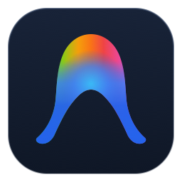

# Antigravity Controller

An unofficial Logi Actions SDK plugin that brings live [Antigravity](https://antigravity.google/) and Antigravity IDE
agent sessions to the **Logitech MX Creative Keypad** (macOS and Windows).

> Unofficial community plugin. Not affiliated with or endorsed by Google or Logitech.
> "Antigravity" and "Gemini" are trademarks of Google LLC.

## Features

- **Up to 16 session slots** – one live tile per project, with a status pill
  (Thinking, Permission, Complete, Stopped, Error, Idle) and a calm orange pulse while an agent works.
  Pressing a slot opens a folder with that session's details and controls.
- **Allow Once / Allow in Conversation / Deny** – answer permission requests without leaving your keyboard.
- **Next Waiting Session** – lights up when an agent waits for you; press to jump to it.
- **Stop / Resume** – stop running agents, then resume them with the same key.
- **New Conversation** and **Open Antigravity**.
- **Context** and **Tokens** – exact context window usage of the model in use, plus token counts.
- **5h / 7d limits** – usage and reset time for Gemini and for third-party models (Claude, GPT).
- **Slot Order** – sticky slots, most recent activity first, or most recent status change first.

Works with both the Antigravity app and Antigravity IDE.

## Requirements

- macOS, or Windows 10/11
- Logi Options+ with the Logi Plugin Service (version 6.0 or later)
- Logitech MX Creative Keypad
- Antigravity and/or Antigravity IDE

### Permissions

**New Conversation** sends Antigravity's own shortcut (Cmd+Shift+L). macOS asks once to allow this:
*System Settings → Privacy & Security → Accessibility → enable "Logi Plugin Service"*.
On Windows it sends Ctrl+Shift+L and needs no extra permission.
All other actions work without extra permissions.

## Privacy

Everything stays on your computer. The plugin only talks to the Antigravity language servers running locally
(127.0.0.1) and reads Antigravity's local session folders. It sends no data to the internet and collects no analytics.

## Known limitations

- Antigravity offers no public API for this. The plugin uses Antigravity's local interfaces, so an Antigravity
  update can break individual features until the plugin is updated.
- Antigravity cannot be asked to open one specific conversation from outside, so slot presses bring Antigravity to the front.

## Support

Found a bug or have a question? [Open an issue](https://github.com/DannyYoung21/logi-antigravity-plugin/issues)
or write to **dannylabs.studio@gmail.com**.

Please include your macOS or Windows version, Antigravity version (app or IDE), and what you pressed and expected.

## Building from source

Requires the .NET SDK and Logi Options+ (the build references `PluginApi.dll` from the Logi Plugin Service).

```bash
dotnet build -c Release src
logiplugintool pack bin/Release AntigravityController_1_2.lplug4
logiplugintool verify AntigravityController_1_2.lplug4
```

A Debug build registers the plugin with the Logi Plugin Service for development.

## License

[MIT](LICENSE) © 2026 Daniele Mazzotta

Use of the plugin is also subject to the [End User License Agreement](EULA.md).
